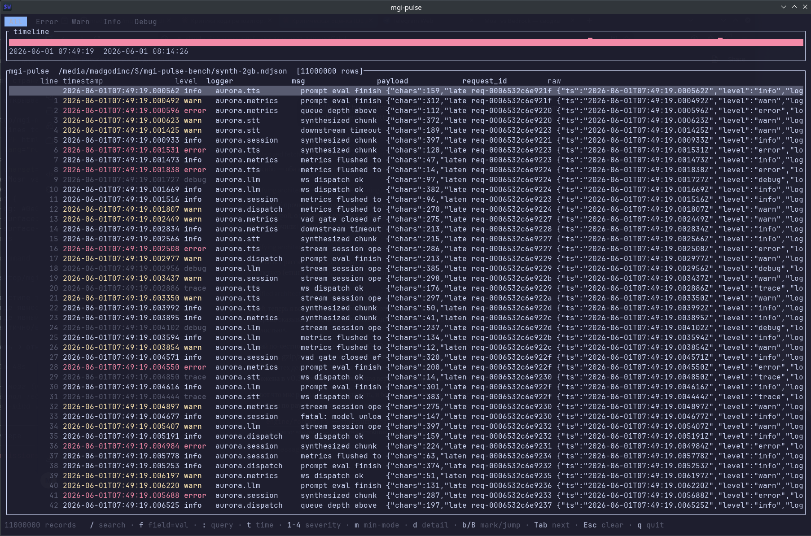
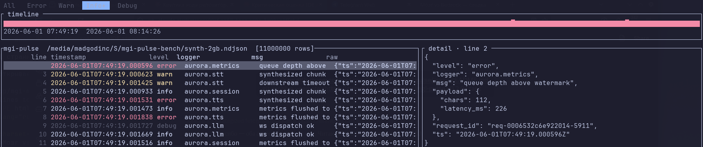
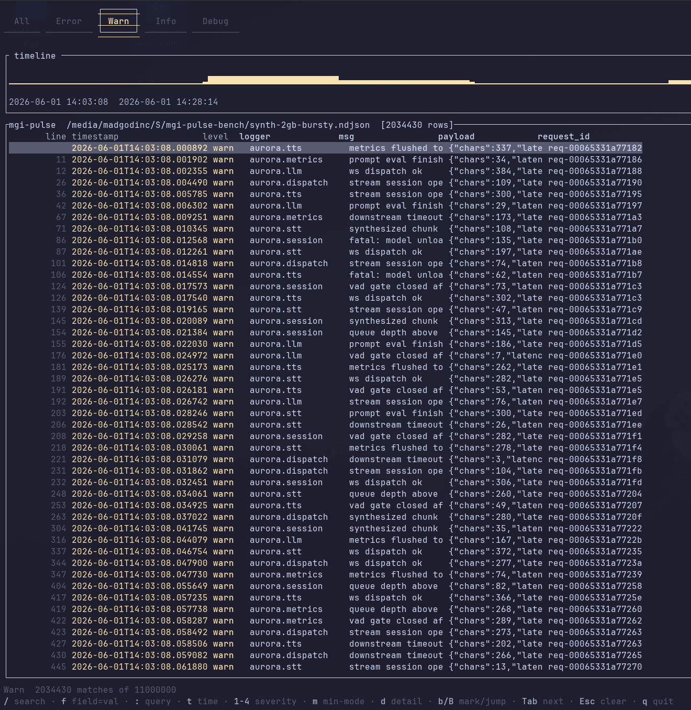
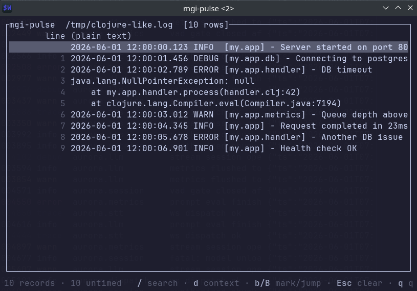
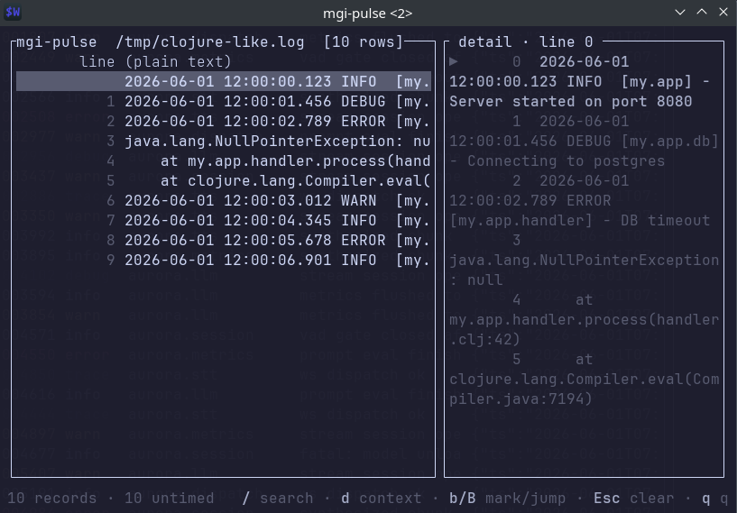

# mgi-pulse

A TUI navigator for local log files. NDJSON-first, ten more formats, regex
escape hatch for the rest.



## Why

I tail `tail -F` and grep `journalctl` like everyone else, and most of the
time that's fine. The case where it isn't: you've got a 2 GB structured log
on disk, you want to see when errors clustered, drill into a request id,
hop to the surrounding context, and you don't want to spin up Loki / Vector
/ a docker-compose to do it once.

Existing tools sit at two extremes. On one side `less` and `tail -F` —
fast, ubiquitous, treat everything as text. On the other a whole pipeline
— a daemon, a schema, a UI. There's a gap in the middle for "one file, one
session, structured awareness, no setup". `lnav` covers part of it and
[`toolong`](https://github.com/Textualize/toolong) used to before it was
deprecated. `mgi-pulse` is the same niche written in Rust with a few more
formats and a different keyboard model.

What it does that text tools don't:

- Parses each record (NDJSON, logfmt, syslog, …) and offers a typed table
  instead of a wall of text.
- Indexes the file once, then filters and timeline-navigates against the
  in-memory indexes — no daemon, no on-disk index, no config file.
- Falls back to a `less`-style view when the input has no structure to
  navigate, so it's safe to point at `/var/log/messages` blind.

## Install

Pre-built Linux x86_64 binary, musl-static, no runtime deps:

```sh
curl -L https://github.com/madgodinc/mgi-pulse/releases/latest/download/mgi-pulse-x86_64-unknown-linux-musl.tar.gz | tar -xz
./mgi-pulse --help
```

Cargo from source (Rust ≥ 1.83):

```sh
cargo install --git https://github.com/madgodinc/mgi-pulse mgi-pulse
```

macOS and Windows builds are CI-checked but not released as binaries —
build from source on those platforms.

## Quickstart

```sh
# One file, autodetect format. NDJSON, logfmt, EDN, syslog, journalctl,
# logback, Apache/nginx access, and JSON-arrays all auto-detect.
mgi-pulse app.log

# Force a format when autodetect would misfire (CSV/TSV/Python/regex
# don't autodetect reliably).
mgi-pulse --format=python  app.log
mgi-pulse --format=csv     audit.csv
mgi-pulse --format=syslog  /var/log/syslog

# Custom log format via named-capture regex. Any plain-text log.
mgi-pulse --pattern='(?P<ts>\d{4}-\d{2}-\d{2}\s\d{2}:\d{2}:\d{2})\s+(?P<level>\w+)\s+(?P<msg>.*)' \
          /opt/myapp/log.txt

# Multiple files: merged by timestamp into one time-sorted stream.
mgi-pulse a.ndjson b.ndjson c.ndjson

# Pipe in stdin. Works for live tails.
tail -F live.log | mgi-pulse -

# Or native follow — backfill the existing file, then a background thread
# follows new appends. Handles logrotate's create/rename and copytruncate.
mgi-pulse --follow live.log

# Compressed input. gzip and zstd are detected by magic bytes, not
# extension.
mgi-pulse app.log.gz
mgi-pulse archive.log.zst
```

Inside the TUI: `Tab` cycles severity views, `/` opens regex search, `:`
opens the query DSL, `f` opens a `field=value` filter, `t` jumps to a
timestamp, `?` shows the stats overlay, `s` saves the filtered view to a
file, `q` quits. Full keyboard reference below.



## Supported inputs

| Format | Flag | Auto-detected | Notes |
|---|---|---|---|
| NDJSON | `--format=ndjson` | yes | The default fallback. `--time-field`/`--level-field` override non-standard names. |
| logfmt | `--format=logfmt` | yes | Go / Heroku `key=value key="quoted"`. |
| EDN | `--format=edn` | yes | Clojure `{:key value}` maps, `#inst`/`#uuid` tagged literals. |
| Python `logging` | `--format=python` | no | `YYYY-MM-DD HH:MM:SS,mmm - logger - LEVEL - msg`. Tracebacks fold. |
| Java logback / log4j2 | `--format=logback` (`log4j`, `java`) | yes | Spring Boot default pattern. Stack traces fold. |
| Syslog RFC 5424 | `--format=syslog` | yes | `<PRI>VERSION TS HOST APP PID MSGID SD MSG`. Structured-data exposed as `SD-ID.key` fields. |
| systemd journalctl JSON | `--format=journalctl` (`journal`, `systemd`) | yes | `journalctl -o json`. PRIORITY maps to severity, `__REALTIME_TIMESTAMP` to time. |
| Apache / nginx access | `--format=access` | yes | Common + Combined Log Format. Severity from HTTP status. |
| CSV / TSV | `--format=csv` / `tsv` | no | RFC 4180 quoting. First row is the column header. |
| JSON array of objects | (auto) | yes | `[{...},{...}]` files are flattened to NDJSON. 64 MB cap; bigger → `jq -c '.[]'`. |
| Generic regex | `--pattern='...'` | no | Named captures `ts`, `level`, plus any other group, become fields. |
| Anything else | (none) | — | Falls into less-mode: line numbers, raw payload, regex search still works. |

Plus gzip and zstd decompression on any of the above (detected by magic
bytes, not extension).

## Demo

The hero screenshot above shows an NDJSON fixture with 11 M records over
25 minutes. The timeline at the top is four severity bands stacked — top
is `Error+Fatal`, then `Warn`, `Info`, `Debug+Trace`. The bursts of red
in the timeline are the incident; the table below is the matching records.

The split below it (`d` toggles) shows what a record's payload looks like
expanded:


Severity tabs (`Tab` cycles, `1`-`4` quick-jumps):



The DSL prompt (`:` or `;`):


Less-mode fallback when the input has no parseable structure:



In less-mode the detail pane shows ±5 lines of context so stack traces
read as a block:



## Query DSL

Press `:` (or `;` if `:` is awkward on your layout — Russian keyboards,
some Mac layouts) to enter a one-line expression. It compiles into the
same predicate machinery the table filters already use:

```text
level=error
level=error AND msg~/timeout/
(level=error OR level=warn) AND NOT logger=health-check
level=error AND (msg~/timeout/ OR msg~/refused/)
ts>=2026-06-01T12:00 AND ts<2026-06-01T13:00
logger=my.app AND msg~/conn(ection)? lost/ AND level!=debug
```

Operators on fields: `=`, `!=`, `~/regex/`, and `>`, `>=`, `<`, `<=` (the
comparison ops only apply to `ts`). Boolean composition: `AND`, `OR`,
`NOT`, parentheses. Precedence is the conventional one — `NOT` binds
tightest, then `AND`, then `OR`. Keywords are uppercase ASCII so they
don't shadow field names like `and_count`.

Syntax errors surface in the status bar before any scan runs.

## Keyboard

| Key | Action | Notes |
|---|---|---|
| `q` / `Ctrl-C` | Quit | |
| `/` | Regex search | `Enter` applies, `Esc` cancels |
| `:` / `;` | Query DSL prompt | `;` is the alt-binding for layouts where `:` needs a modifier |
| `f` | `field=value` filter | Composes with regex and DSL via AND |
| `t` | Jump to a timestamp | RFC3339 prefix, e.g. `2026-06-01T12:00` |
| `s` | Save filtered view to a file | One record per line |
| `?` | Stats overlay | Per-severity counts, time span, top values |
| `]` / `[` | Widen / narrow the auto-columns cap | No restart needed |
| `<` / `>` | Move the timeline scrub cursor | First press activates scrub; Shift jumps 10 |
| `+` / `-` | Zoom timeline | Halve / double, anchored on the cursor |
| `Enter` | Apply scrub as a time-range filter | Single bin if no zoom, the full window otherwise |
| `d` | Detail pane | Pretty-printed JSON; ±5-line context in less-mode |
| `m` | Severity strict / min-mode | `Warn` vs `Warn+` |
| `0`–`4` | Severity quick-filter | `0` clears, `1` Error+Fatal, `2` Warn, `3` Info, `4` Debug+Trace |
| `b` / `B` | Toggle / jump-to-next bookmark | Yellow ★ in the gutter |
| `Esc` | Cancel scrub, or clear filters | First press cancels a scrub; second clears filters |
| `R` | Rescan schema | Useful when the first 10k records were a boot banner |
| `Tab` / `Shift-Tab` | Next / previous tab | |
| `Ctrl-T` / `Ctrl-W` | New / close tab | Last close quits |
| `Up`/`Down`, `PgUp`/`PgDn`, `g`/`G` | Cursor movement | One row, 20 rows, start/end |

### Mouse and terminal selection

Mouse capture is on by default: the wheel scrolls the table, clicks select
tabs. That intercepts the terminal's own text selection — hold `Shift`
while you drag to let the terminal handle the selection directly. Works
in WezTerm, Alacritty, GNOME-Terminal, Konsole, iTerm2. Pass `--no-mouse`
to disable capture entirely if you'd rather keep unmodified terminal
selection (useful over SSH or with a copy-on-select setup).

## Custom field names

NDJSON variants differ on which key holds the timestamp and level. The
defaults are `ts` and `level`; override with `--time-field` and
`--level-field`:

```sh
mgi-pulse --time-field=@timestamp --level-field=severity_text app.log   # ECS
mgi-pulse --time-field=@t app.log                                       # Serilog
mgi-pulse --time-field=eventTime app.log                                # k8s audit
```

## Following live files

Three ways, each safe for a different scenario:

```sh
# 1. Native follow. Backfills the existing content, then a background
#    thread reads appends through a crossbeam channel. Handles
#    logrotate's create/rename mode (inode change) and copytruncate
#    (file shrinks below the read cursor).
mgi-pulse --follow live.log

# 2. Pipe through tail -F. The most portable option, because tail -F
#    is older than most of us and has debugged every rotation edge
#    case across every Unix.
tail -F live.log | mgi-pulse -

# 3. kubectl logs, docker logs and friends: same shape, stdin.
#    For the journal, prefer `mgi-pulse --journal -u myapp -f`.
kubectl logs -f deploy/api | mgi-pulse -
```

A note on `mmap` and live files: `mgi-pulse` mmaps plain files for the
fast indexing path. A file that's truncated by another process while
you're viewing it will deliver SIGBUS — Unix mechanic, not a Rust error,
not catchable. So **don't open an actively-rotating file with `mgi-pulse
app.log` directly**; use one of the three options above. Static log
snapshots (`app.log.1`, archived dates) are fine.

## systemd journal

`--journal` reads the journal directly through `journalctl -o json`, so
there is nothing to link against and the binary stays the same on every
platform. It needs `journalctl` on the PATH, which in practice means
Linux with systemd; elsewhere it exits with a message saying so.

```sh
mgi-pulse --journal                          # current boot
mgi-pulse --journal -u nginx -u api --since 2h
mgi-pulse --journal -u api --since today -f  # backfill, then follow
```

`--since` takes an age (`30m`, `2h`, `1d`), an RFC3339 time, or anything
`journalctl --since` understands. Without it you get the current boot.
`PRIORITY` maps to the severity tabs (0-2 fatal, 3 error, 4 warn, 5-6
info, 7 debug), `__REALTIME_TIMESTAMP` drives the timeline, and every
journal field stays queryable: `unit`, `host` and `ident` are short
aliases for `_SYSTEMD_UNIT`, `_HOSTNAME` and `SYSLOG_IDENTIFIER`, and
`_PID`, `_COMM` and the rest work under their own names.

```text
unit=nginx.service AND level=error
_PID=4121 AND msg~/oom/
```

Follow mode remembers the cursor of the last backfilled entry and
continues from it, so nothing lands twice and nothing goes missing in
between. Piped journal output is detected too:
`journalctl -o json -u api | mgi-pulse -`.

## Watch mode

`mgi-pulse watch` runs without a terminal and prints only the records
that match a rule. Rules are the same query DSL the TUI uses. Repeats
of one message collapse into a single count, so a crash loop prints
two lines instead of two thousand.

```sh
mgi-pulse watch app.log                          # errors and fatals, follow
mgi-pulse watch app.log --rule 'msg~/timeout/' --rule 'level=error'
mgi-pulse watch --journal -u api -u nginx --collapse 5m
kubectl logs -f deploy/api | mgi-pulse watch - --format json
mgi-pulse watch --once --since 1h app.log        # scan and exit
```

```text
2026-06-01T12:00:02.000Z error api.log [rule1] upstream timeout after 30s
2026-06-01T12:10:02.000Z error api.log [rule1] +41 more in 10m: upstream timeout after 30s
```

- Without `--rule`, error and fatal records match. With several rules,
  the first one that matches a record names it.
- `--collapse` (default `10m`, `0` turns it off) groups repeats by rule,
  source and message, with digits ignored: `retry 3 failed` and
  `retry 4 failed` count as one message.
- Files are followed from their current end; `--from-start` reads the
  existing content first, and `--once` reads it and exits. With
  `--once` the collapse window runs on record timestamps, so last
  night's burst collapses the way it would have live.
- `--format json` prints one object per line: `{"type":"match", ...}`
  for a record, `{"type":"repeat","count":41, ...}` for a closed window.
- The exit code is non-zero only for fatal errors: a bad rule, a missing
  file, no `journalctl`. A closed stdout (`| head`) ends the watch
  quietly.

Sources and rules can live in a TOML file instead of flags:

```toml
# pulse.toml
collapse = "10m"
output = "text"

[[source]]
name = "api"
path = "/var/log/api/app.ndjson"   # relative paths resolve next to this file

[[source]]
name = "web"
journal = ["nginx.service"]        # [] reads the whole journal

[[rule]]
name = "timeouts"
query = "msg~/timeout/"

[[rule]]
name = "errors"
query = "level=error OR level=fatal"
```

```sh
mgi-pulse watch --config pulse.toml
```

## Telegram

Watch mode can send its matches to Telegram and answer a few read-only
commands, through a bot you create yourself. Nothing goes through a
third-party service: pulse talks to the Bot API over HTTPS with long
polling, so it needs no open port.

Setup:

1. Message [@BotFather](https://t.me/BotFather), send `/newbot`, and keep
   the token it gives you.
2. Send your new bot any message, then find your numeric user id, for
   example with [@userinfobot](https://t.me/userinfobot). For a group,
   add the bot to it; group ids are negative.
3. Put the token in the environment (or in a file, see below) and add a
   `[telegram]` section to the watch config.

```sh
export MGI_PULSE_TELEGRAM_TOKEN='123456789:AA...'
mgi-pulse watch --config pulse.toml
```

```toml
[telegram]
alert_chats = [123456789]       # who receives alerts
allowed_users = [123456789]     # who may send commands
# allowed_chats = [-1001234567] # every member of these chats may
# token_file = "/etc/mgi-pulse/tg-token"   # instead of the env variable
# token_env = "MY_BOT_TOKEN"    # a different variable name
# max_per_minute = 20           # alert messages per chat
```

Alerts are the same lines watch prints, batched for two seconds into one
message and rate-limited per chat. Repeats arrive as one `+41 more in
10m` line, as on the terminal. A `[[rule]]` with `alert = false` prints
but never alerts.

Commands answer only senders listed in `allowed_users` or chats listed
in `allowed_chats`. Everyone else gets no reply at all, and with both
lists empty the bot does not read messages. Commands are read-only and
address sources by their configured name, so a chat can't ask for a
path outside the config or run anything:

| Command | Answer |
|---|---|
| `/tail [n] [source]` | Last `n` lines (default 20, at most 200) |
| `/errors [age] [source]` | Errors and fatals of the last hour, or `age` |
| `/grep <query>` | Query DSL over every source, newest 50 matches |
| `/stats [age]` | Per-source level counts and top messages, rule hit counts |
| `/sources`, `/rules` | What is configured |
| `/mute <rule\|all> [duration]`, `/unmute [rule\|all]` | Silence alerts for a while (default 1h) |

Answers longer than a screen arrive as a `.txt` attachment. The token
never appears in the config, in logs or in error messages, and pulse
refuses a `token = ...` line in the config file. A token file readable
by other users gets a warning.

## MCP server for AI agents

`mgi-pulse mcp` gives an AI agent read-only tools over the log sources you
name when you start it. The agent never passes a path: it picks a source
by name from `list_sources`, so it reads only what you configured, and it
can't run anything.

| Tool | What it returns |
|---|---|
| `list_sources` | Configured sources and their names |
| `tail` | Last N records of one source |
| `search` | Records matching a query DSL expression, optionally in a time window |
| `errors` | Error and fatal records, last hour by default |
| `stats` | Counts per level, time span, top loggers and most frequent messages |
| `watch_once` | Waits up to two minutes for new records matching a rule |

Answers are capped at 200 records with lines cut at 1000 characters, and
every answer says how many records matched in total and whether it was
truncated.

```sh
mgi-pulse mcp /var/log/api/app.ndjson /var/log/nginx/error.log
mgi-pulse mcp --journal -u nginx -u api
mgi-pulse mcp --config pulse.toml              # the [[source]] list of a watch config
mgi-pulse mcp --http 127.0.0.1:8765 app.log    # Streamable HTTP on /mcp instead of stdio
```

The server speaks MCP over stdio by default and over Streamable HTTP with
`--http`. It answers both the `initialize` handshake of protocol versions
2024-11-05 to 2025-11-25 and the stateless 2026-07-28 revision
(`server/discover`), so older and newer clients both work. It writes
nothing but protocol messages to stdout.

`--http` binds to the address you give it. On anything other than
loopback it refuses to start without a bearer token in
`MGI_PULSE_MCP_TOKEN` (or the variable named by `--token-env`). Browser
`Origin` headers other than localhost get 403 unless allowed with
`--allow-origin`.

### Client setup

The examples serve one file and the `nginx` journal unit; put your own
sources after `mcp`. GUI clients often start without your shell's PATH,
so use the absolute path to the binary there (`which mgi-pulse`, or
`where mgi-pulse` on Windows).

**Claude Code**

```sh
claude mcp add --transport stdio --scope user pulse -- mgi-pulse mcp /var/log/app.ndjson --journal -u nginx
```

**Claude Desktop**: `claude_desktop_config.json` (macOS
`~/Library/Application Support/Claude/`, Windows `%APPDATA%\Claude\`).
Cursor (`~/.cursor/mcp.json` or `.cursor/mcp.json`), Windsurf / Devin
Desktop (`~/.config/devin/mcp_config.json`, Windows
`%APPDATA%\devin\mcp_config.json`), Cline (MCP Servers panel, Configure
MCP Servers), LM Studio (Program tab, Install, Edit mcp.json) and Gemini
CLI (`~/.gemini/settings.json`) take the same block:

```json
{
  "mcpServers": {
    "pulse": {
      "command": "/usr/local/bin/mgi-pulse",
      "args": ["mcp", "/var/log/app.ndjson", "--journal", "-u", "nginx"]
    }
  }
}
```

**VS Code** (Copilot agent mode): `.vscode/mcp.json` in the workspace, or
**MCP: Open User Configuration** for every workspace.

```json
{
  "servers": {
    "pulse": {
      "type": "stdio",
      "command": "mgi-pulse",
      "args": ["mcp", "/var/log/app.ndjson", "--journal", "-u", "nginx"]
    }
  }
}
```

**OpenAI Codex CLI**: `~/.codex/config.toml`, or
`codex mcp add pulse -- mgi-pulse mcp /var/log/app.ndjson`.

```toml
[mcp_servers.pulse]
command = "mgi-pulse"
args = ["mcp", "/var/log/app.ndjson", "--journal", "-u", "nginx"]
```

**Zed**: `settings.json`.

```json
{
  "context_servers": {
    "pulse": {
      "command": "mgi-pulse",
      "args": ["mcp", "/var/log/app.ndjson", "--journal", "-u", "nginx"]
    }
  }
}
```

**Continue**: a block file such as `.continue/mcpServers/pulse.yaml`.

```yaml
name: pulse
version: 0.0.1
schema: v1
mcpServers:
  - name: pulse
    type: stdio
    command: mgi-pulse
    args: ["mcp", "/var/log/app.ndjson", "--journal", "-u", "nginx"]
```

**Goose**: `~/.config/goose/config.yaml` (Windows
`%APPDATA%\Block\goose\config\config.yaml`).

```yaml
extensions:
  pulse:
    type: stdio
    name: pulse
    enabled: true
    cmd: mgi-pulse
    args: ["mcp", "/var/log/app.ndjson", "--journal", "-u", "nginx"]
    timeout: 300
```

**Open WebUI**: through the [mcpo](https://github.com/open-webui/mcpo)
proxy, which turns the tools into an OpenAPI server you add under
Settings, Tools:

```sh
uvx mcpo --port 8000 --api-key "change-me" -- mgi-pulse mcp /var/log/app.ndjson
```

Clients that connect to a URL instead of starting a process can use
`--http`: point them at `http://127.0.0.1:8765/mcp`, with an
`Authorization: Bearer ...` header when a token is set.

Tested with Claude Code, the MCP Inspector CLI (TypeScript SDK, stdio and
HTTP), the official Python SDK 2.3 (stdio and HTTP, protocol 2026-07-28),
the Python SDK 1.30 handshake path, and mcpo. The other clients above are
configured from their current documentation.

## Bookmarks persistence

`b` toggles a bookmark on the focused row, `B` cycles through them. For
single-file sources, bookmarks survive between sessions via a JSON
sidecar at `$XDG_DATA_HOME/mgi-pulse/bookmarks.json` (default
`~/.local/share/mgi-pulse/bookmarks.json`). The sidecar is keyed by the
file's inode and size; a rotated or truncated file drops its saved
bookmarks automatically so the marks don't land on unrelated content.
Stdin and merged sources skip persistence — no stable identity to
key on.

## What it doesn't do

- **Plain-text without `--pattern`.** Unstructured logs fall into
  less-mode — usable, but no typed fields, no severity tabs, no
  per-field DSL. Pass `--pattern='(?P<ts>...)...'` to lift them into
  the structured path.
- **Files larger than RAM minus index headroom.** The index lives
  in memory (one entry per record across three parallel arrays); a
  30 GB file is fine on a 64 GB box but blocks the UI during the
  synchronous backfill.
- **Live editing of running queries with very large indexes.**
  Predicates re-scan the index on each filter change. Sub-second on
  2 GB / 11 M records (i5-12400F); minutes on 100 GB.
- **Remote / multi-host / persistence between machines.** There's no
  on-disk index, and `watch` follows one machine's files and journal. If you need to correlate across a
  fleet, you want Loki, Vector, an OTEL collector, not this.
- **Windows-native rotation handling.** The follow worker's inode
  check falls back to file size on non-Unix platforms; copytruncate
  is detected the same way (size shrink) but rename-rotation on
  Windows may not be picked up until the file shrinks or grows.

## Comparison

Roughly the same niche:

- **`lnav`** is the prior art and the closest peer — battle-tested,
  C++, broader format library, SQL queries. `mgi-pulse` is younger,
  fewer formats today, but a different keyboard model (severity tabs,
  one-line DSL instead of SQL) and a Rust toolchain if that matters
  to you.
- **`toolong`** had the same idea in Python on top of Textual; the
  Textualize team [archived it](https://github.com/Textualize/toolong)
  in 2025. `mgi-pulse` covers the same demo workflow.
- **`klogg`** is the GUI option for big files. If you want a desktop
  GUI you want `klogg`. If you want a terminal session you want this
  or `lnav`.

Not the same niche:

- **`less`, `tail`, `bat`** — text-first. Use them for "I just want
  to see the file".
- **Loki / Vector / OTEL collectors** — pipeline-first. Use them for
  "I'm running a service and want to see across instances".

## Performance reference

End-to-end index of a 2 GB / 11 M-record synthetic NDJSON file:
**~2.8 seconds** on an i5-12400F (6c/12t, ext4 on NVMe). Throughput
~700 MB/s, ~4 M records/s. See [BENCHMARKS.md](BENCHMARKS.md) for the
hot-path breakdown and what's explicitly not measured.

These are reference numbers from one dev box, not a guarantee. Real
workloads on real boxes will vary; the indexer-bench binary in
`bench/parse-bench/` reproduces them for your hardware.

## License

Apache-2.0. See [LICENSE](LICENSE).

## Acknowledgments

Built on:

- [ratatui](https://github.com/ratatui/ratatui) — TUI rendering
- [crossterm](https://github.com/crossterm-rs/crossterm) — input / mouse
- [memmap2](https://github.com/RazrFalcon/memmap2-rs) — mmap
- [serde](https://serde.rs/) / [serde_json](https://github.com/serde-rs/json) — borrowed JSON parsing
- [regex](https://github.com/rust-lang/regex) — search and `--pattern`
- [flate2](https://github.com/rust-lang/flate2-rs) / [zstd](https://github.com/gyscos/zstd-rs) — decompression
- [crossbeam-channel](https://github.com/crossbeam-rs/crossbeam) — follow-worker → UI

Inspired by [`lnav`](https://github.com/tstack/lnav) and
[`toolong`](https://github.com/Textualize/toolong) — same idea, different
tradeoffs.
